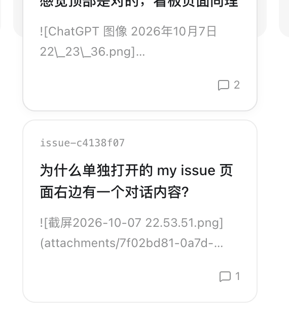

# Description

MyIssue 看板的列背景应保持在可用看板区域内固定高度。卡片数量增加时，列背景不随卡片内容继续变高；超出可见区域的卡片由列内纵向滚动查看，不能溢出背景。

来源：[`issue-00029_看板列固定高度，卡片裁切并在列内上下滚动`](../../issues/issue-00029_%E7%9C%8B%E6%9D%BF%E5%88%97%E5%9B%BA%E5%AE%9A%E9%AB%98%E5%BA%A6%EF%BC%8C%E5%8D%A1%E7%89%87%E8%A3%81%E5%88%87%E5%B9%B6%E5%9C%A8%E5%88%97%E5%86%85%E4%B8%8A%E4%B8%8B%E6%BB%9A%E5%8A%A8.md)。

- [x] 看板列和列背景填满工具栏以下的可用高度，不由卡片总高度撑开。
- [x] 列标题保持固定，卡片列表在列背景内纵向滚动。
- [x] 保留看板横向滚动和卡片拖动状态列的行为。
- [x] `npm run check` 与 `npm run build` 通过；构建已更新插件内嵌看板页面。
- [ ] 用户验收：确认卡片不会越出列背景，且可在列内滚动查看。

# Comments

## 20261026-113344_Codex_Unknown

按当前用户要求实现来源 MyIssue issue 的看板列高度与卡片滚动行为。`src/web/style.css` 让看板面板受可用高度约束、看板保留横向滚动、列采用纵向 flex 并裁切边界，标题固定，卡片列表独立纵向滚动；生成的 `plugins/myissue/assets/board.html` 已同步更新。`npm run check` 和 `npm run build` 通过；未运行测试或进行宿主界面的视觉验收，保留用户验收项。
